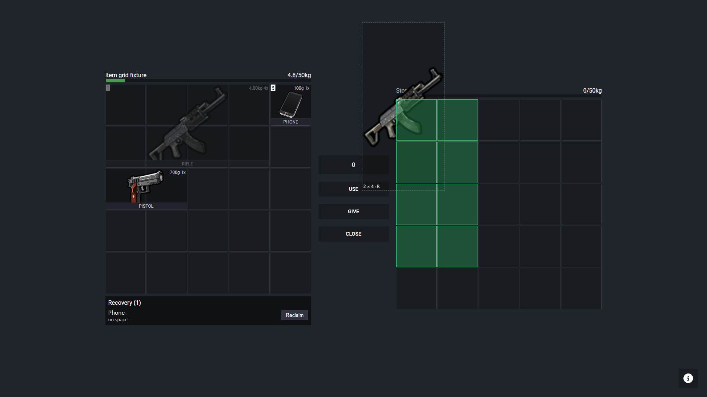

# Verification record

The checks execute the real server modules and the real NUI. Runtime boundaries remain explicit. Commands and fixture details are in [the test instructions](../../tests/README.md).

| Check | Recorded result | Scope |
| --- | --- | --- |
| Native CfxLua suites | 191 passed, zero failed | Actual exports, registered callbacks, hooks, planners, loaders and serializers |
| Bun tests | 39 passed, zero failed | Shared geometry vectors, full-state refreshes, pending rejection and browser fixture behavior |
| `bun x tsc --noEmit` | Passed | NUI types |
| `bun run build` | Passed | Production NUI bundle |
| `node tests/browser.mjs` | Six checks passed, no page errors | Real Chrome pointer drag, R rotation, footprint preview, split, rejection and reclaim |
| Native Lua parsing | 61 files passed | CfxLua syntax, without source rewriting |
| LuaLS with installed CfxLua plugin and native types | Zero errors; 1,229 warnings | Baseline had 1,331 warnings. Warning mode exits nonzero and is not claimed clean |
| Fresh pinned CfxLua build helper | Passed | Reproducible interpreter build using MSVC |

The smaller LuaLS warning total is not a clean regression check. New inferred-field and nil-check warnings remain alongside baseline diagnostics. These are unresolved type-analysis debt; only the zero-error result is claimed.

The [native output](native-results.txt) lists the executed cases. The [baseline output](../../tests/baseline-output.txt) captures old behavior before production edits. The old AddItem admitted a phone into a rifle's covered cell, admitted an off-edge rifle and admitted excess weight. Desired rejection tests failed before the implementation. They pass in the new suite.

Native tests cover default 1x1 compatibility, clipped rows, both orientations, exact destinations, multi-item atomicity, swaps, splits, stacks, giving, drops, payment and ingredients freeing cells, durability, nested weight accounting, malicious numeric inputs, hook reentrancy and mutations during progress. Persistence cases cover relocation, unknown and malformed records, recovery weight, reclaim, capacity changes, saves, confiscation, return, failed writes and explicit empty ESX ownership. The actual MySQL module is exercised to inspect query and transaction shapes.

Additional regressions execute actual framework bridge modules and extracted real client update handlers. They cover disconnect cleanup, repeated confiscation, recovery ID collisions, canonical item-table inputs, fresh durability records and equipped-weapon remapping before slot deletion. A fresh verifier independently passed the 191 checks and five additional failure/lookup scenarios after the review fixes.

Browser screenshots show explicit development fixtures, with a solid background added for visibility. They are not screenshots from FiveM. The browser fixture supplies success or rejection; it does not prove server transport. Native server tests establish the corresponding authoritative decisions independently.

[1280x720 split-stack screenshot](screenshots/split-1280.png).

## Limits

No live FiveM server or game client was configured. Multiplayer transport, actual game natives, equipped-weapon animation, framework resource lifecycles and live SQL transaction behavior remain unverified. Database tests capture real query construction and emulate outcomes; they do not execute a database engine. The default native fixture also simplifies item metadata policy, while selected tests explicitly load the real item modules.

The connected browser tool returned no browsers. A separate headless Chrome run through Playwright supplied actual pointer evidence. This does not establish touch input, every screen resolution or the embedded FiveM CEF version.

The independent [review record](review.md) records demonstrated defects and their treatment. Passing tests do not replace that review or the runtime limitations above.
